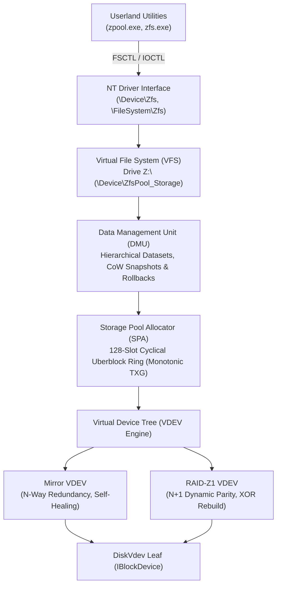

# TitanZFS

**Sovereign clean-room modern ISO C++23 native ZFS kernel driver & storage pooling engine for Windows NT and MicaNT.**

Zero external dependencies. Sub-100KB binary footprint. Enterprise-grade storage virtualization, RAID-Z1 single parity, mirror self-healing, 256-bit Fletcher-4 bit-rot protection, and instantaneous Copy-on-Write (CoW) snapshots.

---

## Architecture Overview

TitanZFS is engineered from first principles in pure, freestanding ISO C++23. Unlike traditional ZFS ports to Windows that wrap large legacy CDDL / Solaris Porting Layer (SPL) codebases, TitanZFS is designed specifically as a native NT Installable File System (IFS) driver:



---

## Core Capabilities

### 1. 256-Bit Fletcher-4 End-to-End Checksums
Every 128-byte Block Pointer (`blkptr_t`) embeds a 256-bit Fletcher-4 checksum computed across four 64-bit accumulators over 32-bit words:
$$\begin{aligned}
A &= \sum x_i \pmod{2^{64}} \\
B &= \sum A \pmod{2^{64}} \\
C &= \sum B \pmod{2^{64}} \\
D &= \sum C \pmod{2^{64}}
\end{aligned}$$
Any bit-flip or silent data corruption immediately triggers `STATUS_DATA_CHECKSUM_ERROR (0xC00002EB)` and transparent self-healing.

### 2. RAID-Z1 Dynamic Single Parity Engine
In an $N+1$ stripe configuration (e.g. 2 data disks + 1 parity disk), TitanZFS generates dynamic parity blocks on the fly using fast XOR SIMD passes. If any single drive faults or goes offline, reads to that drive are dynamically reconstructed in-memory without downtime.

### 3. N-Way Mirror Self-Healing Read Repair
When reading from a mirror VDEV, if a child disk reports a checksum verification failure, TitanZFS automatically falls back to an alternate healthy mirror branch, retrieves the verified data, and repairs the corrupt child disk in-place.

### 4. 128-Slot Uberblock Ring Buffer
Storage pool transactions are committed monotonically through a 128-slot cyclical Uberblock ring buffer (`ub_magic = 0x00BAB10C`, SPA version `5000`). The active root is discovered by identifying the highest valid monotonic TXG.

### 5. Instantaneous CoW Snapshots & Rollbacks
Datasets support $O(1)$ instantaneous Copy-on-Write snapshot creation (`zfs snapshot dataset@snap`) and atomic rollback (`zfs rollback dataset@snap`), preserving directory hierarchies and block pointer trees.

---

## Command Line Utilities

### `zpool` - Storage Pool Management
```text
usage: zpool <subcommand> <args ...>

Subcommands:
  status [-v] [pool]       Show pool status, VDEV topology, and error statistics
  list [pool]              List storage pool summaries, capacities, and health
  create <pool> <type> ... Create a new storage pool (raidz1, mirror, stripe)
  scrub <pool>             Initiate background bit-rot checksum scrub and repair
  clear <pool>             Clear device error counters and transient fault latches
  destroy <pool>           Destroy an existing storage pool
```

### `zfs` - Dataset & Snapshot Administration
```text
usage: zfs <subcommand> <args ...>

Subcommands:
  list [-r] [dataset]      List datasets, sizes, mounts, and refer properties
  create <dataset>         Create a new ZFS hierarchical dataset
  snapshot <dataset@snap>  Create an instantaneous O(1) Copy-on-Write snapshot
  rollback <dataset@snap>  Atomically revert dataset state to a specific snapshot
  destroy <dataset[@snap]> Destroy a dataset or snapshot
```

---

## Building & Testing

### Requirements
- Any modern C++23 compiler:
  - **Windows**: Clang 18+, MSVC 19.38+ (VS 2022 17.8+), or GCC 13+
  - **Linux**: Clang 18+ or GCC 13+
- CMake 3.24+

### Build with CMake
```bash
git clone https://github.com/MicaNT-Kernel/TitanZFS.git
cd TitanZFS

# Configure & Build
cmake -B build -DCMAKE_BUILD_TYPE=Release
cmake --build build --config Release

# Run Unit Tests
ctest --test-dir build --output-on-failure
```

---

## Relationship to MicaNT

TitanZFS was originally conceived and designed as the storage pooling and RAID subsystem for **[MicaNT](https://github.com/MicaNT-Kernel/MicaNT)**—the sovereign clean-room modern ISO C++23 NT operating system executive. Because of its standalone, zero-dependency freestanding design, it is published as an independent project for the broader Windows NT and systems programming community.

---

## License

Licensed under the Apache License, Version 2.0 (the "License"). You may obtain a copy of the License in the [`LICENSE`](LICENSE) file or at:
http://www.apache.org/licenses/LICENSE-2.0
